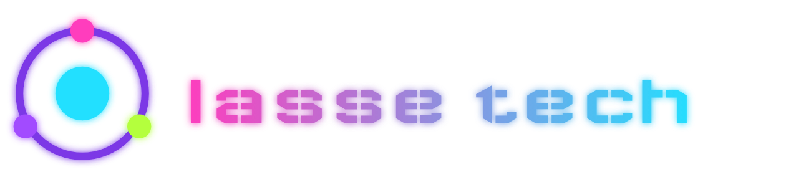

  

### lasse tech

Games, addons and tools for gamers

| | |
|---|---|
| [**Palaver**](https://palaver.social) | voice, text and screen-share chat for gamers |
| [**Raidex Keys**](https://raidex.app/keys/) | Mythic+ keystones, rating and Great Vault of every alt |
| [**Tallymaster**](https://github.com/lasse-tech/tallymaster) | WoW addon: items and currencies, account-wide, by category |
| [**Gearwright**](https://github.com/lasse-tech/gearwright) | WoW addon: best-in-slot enchants, gems, consumables and stat targets |

### Lars Gossard

Private projects

| | |
|---|---|
| [**ModRunner**](https://github.com/lasse-tech/modrunner) | player for Amiga tracker modules |
| [**Sizely**](https://github.com/lasse-tech/sizely) | Cinnamon extension: window sizes and centering |
| [**Mini Studio**](https://github.com/lasse-tech/mini-studio) | IDE for the Calliope mini 3 |

  <a href="https://lasse-tech.de">lasse-tech.de</a> ·
  <a href="https://buymeacoffee.com/gossardla">Buy me a coffee</a>

